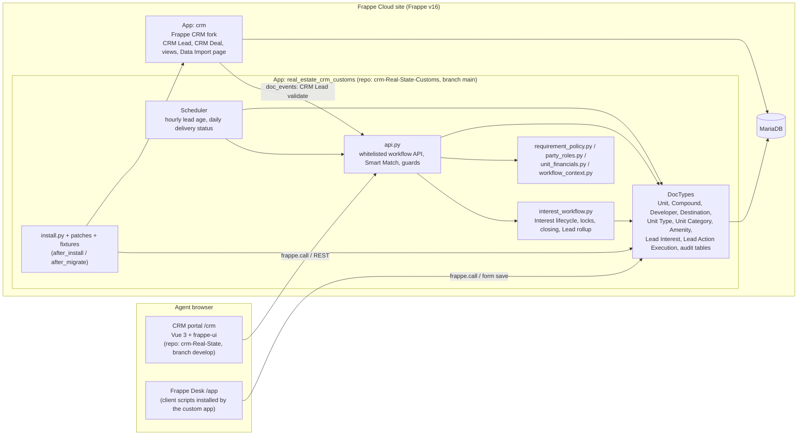
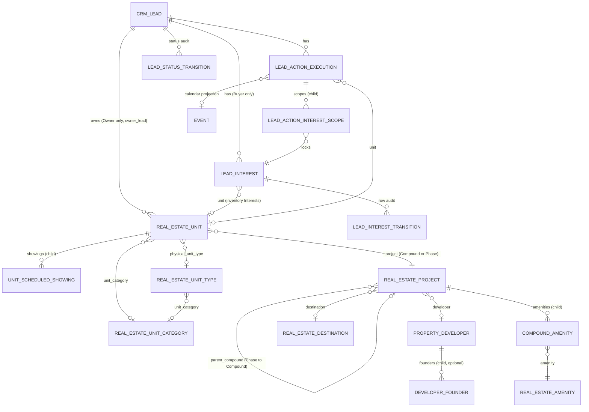
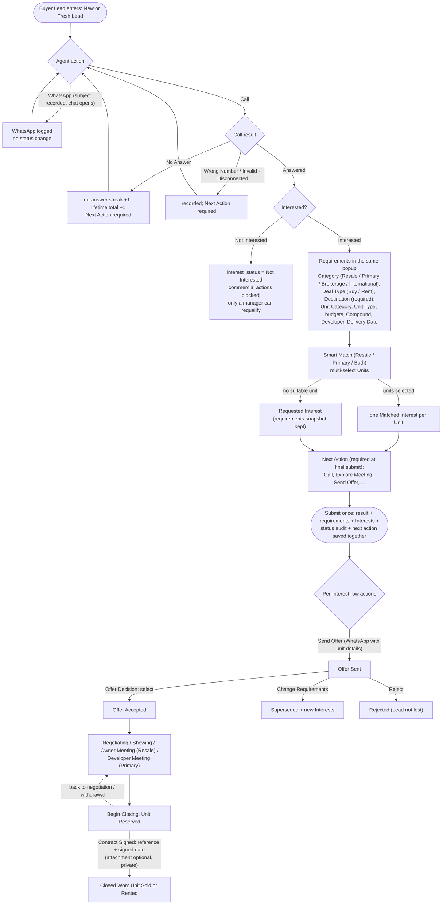
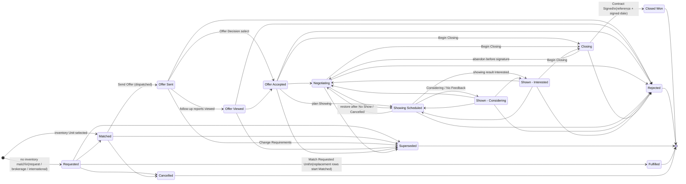
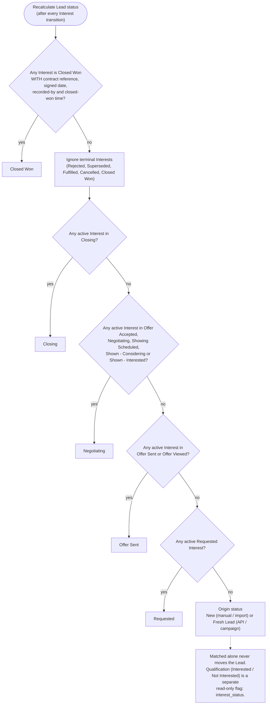
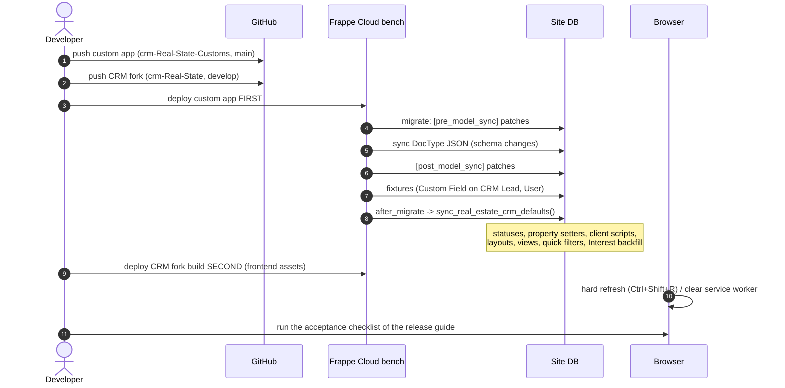

# Real Estate CRM: Technical Guide

**Audience:** developers, implementers, administrators, and anyone who needs to understand how the system works.
**Snapshot:** 28 October 2026. Custom app `crm-Real-State-Customs` on `main` at `fcc458c`. CRM fork `crm-Real-State` on `develop` at `1810fd3c`.
**Companion files:** [`AGENTS.md`](../AGENTS.md) is the condensed rulebook for AI coding agents. The editable diagrams in [`diagrams/`](diagrams/) are the sources for every diagram in this guide.

---

## Contents

1. [Purpose and scope](#1-purpose-and-scope)
2. [Architecture](#2-architecture)
3. [Business concepts](#3-business-concepts)
4. [Data model](#4-data-model)
5. [Buyer workflow](#5-buyer-workflow)
6. [Interest lifecycle](#6-interest-lifecycle)
7. [Lead status rollup](#7-lead-status-rollup)
8. [Owners and Units](#8-owners-and-units)
9. [Closing and Unit status](#9-closing-and-unit-status)
10. [Smart Match](#10-smart-match)
11. [Compounds, Phases and the master data](#11-compounds-phases-and-the-master-data)
12. [Sale and Rent](#12-sale-and-rent)
13. [Phone and WhatsApp numbers](#13-phone-and-whatsapp-numbers)
14. [Permissions](#14-permissions)
15. [Backend code tour](#15-backend-code-tour)
16. [Frontend code tour](#16-frontend-code-tour)
17. [API reference](#17-api-reference)
18. [Installation, migration and patches](#18-installation-migration-and-patches)
19. [Importing data](#19-importing-data)
20. [Testing](#20-testing)
21. [Deployment](#21-deployment)
22. [Troubleshooting](#22-troubleshooting)
23. [Change history](#23-change-history)
24. [Open work](#24-open-work)

---

## 1. Purpose and scope

The system is a CRM for a real-estate brokerage that also sells developer (primary) inventory. It is built on **Frappe Framework v16** and **Frappe CRM**, and runs on **Frappe Cloud**. It answers four everyday questions for a sales team:

- **Who is this person?** A Lead is either a **Buyer** (someone looking for a property) or an **Owner** (someone who lists a property).
- **What does the Buyer want?** Every requirement and every Unit offered to the Buyer is an independent **Interest** with its own progress.
- **What should the agent do next?** The system guides the agent through allowed actions, always ending with a planned next action.
- **What inventory fits?** **Smart Match** ranks available Units against the Buyer's requirement and explains every score.

Standard Frappe CRM features (Deals, Contacts, Organizations, telephony, email) still exist. The real-estate features are added by a separate custom app, so the CRM fork can keep following upstream with minimal conflicts.

## 2. Architecture

The site runs two Frappe apps from two Git repositories.

| | Custom app | CRM fork |
|---|---|---|
| Repository | `Cloudy-Z/crm-Real-State-Customs` | `Cloudy-Z/crm-Real-State` |
| Frappe app name | `real_estate_crm_customs` | `crm` |
| Branch | `main` | `develop` |
| Owns | Data model, business rules, workflow engine, Smart Match, migrations, Desk scripts, portal layouts | The `/crm` portal (Vue 3, frappe-ui, Tailwind, Vite) |



Design principles:

- **The server is the authority.** Every rule shown in the UI is enforced again in Python. The UI only makes the rule convenient.
- **Additive customisation.** CRM Lead is extended with Custom Fields (fixtures), Property Setters and hooks. Upstream CRM DocType JSON is not edited for business fields.
- **Small pure modules.** Rules that do not need the database (roles, money, requirement validation, migration decisions) live in pure modules, so they can be unit-tested without a Frappe bench.
- **One transaction per agent submit.** The unified action form saves everything in one request. If any validation fails, everything rolls back together.

## 3. Business concepts

| Concept | Description |
|---|---|
| **Lead** | A person in `CRM Lead`. Its **Party Role** (`party_type`) is `Buyer` or `Owner`. This is the only role field. |
| **Buyer** | Looks for a property to buy or rent. Moves through the guided action cycle. |
| **Owner** | Owns one or more Units and lists them for sale, rent, or both (`owner_intent`). Called "Seller" before 28 Oct 2026. |
| **Unit** | A property in inventory: `Primary` (developer stock), `Resale` (owner stock), or `International`. |
| **Compound** | A residential project. A Compound may have **Phases**, which are themselves Compound records with `record_type = Phase`. |
| **Developer** | The company that builds Compounds. |
| **Destination** | The area or city (for example New Cairo or North Coast). Required on every property requirement. |
| **Interest** | One Buyer requirement (Requested) or one Unit offered to a Buyer (Matched and later states). Each Interest progresses on its own. |
| **Action** | Something the agent does or plans to do: Call, Add Interest, Meeting, Showing, Send Offer, Offer Decision, Negotiation Follow-up, Closing. |
| **Lead status** | A read-only summary of the Lead's Interests, used for pipeline reporting. |
| **Qualification** | `interest_status` = Interested / Not Interested. A separate read-only flag. |

## 4. Data model



### 4.1 DocTypes of the custom app

| DocType | Kind | Import | Change log | Purpose and key rules |
|---|---|---|---|---|
| Real Estate Unit | Master | Yes | Yes (views tracked too) | Inventory. Required: Unit Number, Compound (`project`), Inventory Type, Listing Purpose, Area UOM, Bedrooms, Bathrooms, Status. SKU, Master Compound, Destination, Developer, totals and delivery status are calculated. |
| Real Estate Project (shown as **Compound**) | Master | Yes | Yes | `record_type` Compound or Phase. A Phase needs `parent_compound` and inherits Developer and Destination from it. Status is optional. |
| Property Developer | Master | Yes | No | Only Developer Name is required. Founded In is an optional date. Founders are optional. |
| Real Estate Destination | Master | Yes | No | Areas and cities. |
| Real Estate Unit Category | Master | Yes | No | 16 default categories seeded on first install (for example Residential, Commercial, Administrative). |
| Real Estate Unit Type | Master | Yes | No | Linked to a Unit Category. Its abbreviation is used in the SKU. |
| Real Estate Amenity | Master | Yes | No | Compound amenities. |
| Lead Interest | Workflow | **No** | Yes | The workflow authority for each requirement or offered Unit. Created only by the workflow. |
| Lead Action Execution | Workflow | **No** | No | Planned and completed actions. |
| Lead Action Interest Scope | Child | No | — | Which Interests an action covers and locks. |
| Lead Interest Transition / Lead Status Transition | Audit | **No** | — | Append-only history of every state change. |
| Unit Scheduled Showing | Child of Unit | — | — | Showings planned for the Unit. |
| Real Estate Compound Amenity / Compound Unit Type | Child of Compound | — | — | Amenities and available Unit Types. |
| Real Estate Compound Phase | Child of Compound | — | — | **Legacy**, read-only. Phases are now Compound records. |
| Property Developer Founder | Child of Developer | — | — | Optional. Fully empty rows are dropped on save. |
| Lead Interested Unit | Child of CRM Lead | — | — | **Legacy compatibility mirror**. Never used for decisions. |

### 4.2 Fields added to CRM Lead (fixtures)

| Field | Type | Notes |
|---|---|---|
| `party_type` | Select Buyer / Owner | The only role field. Cannot change while the Lead owns Units or has Interests. |
| `owner_intent` | Select Sell / Rent / Sell or Rent | Owners only. Default for new Units from that Owner. |
| `whatsapp_number` | Phone | Stored in Desk format `+CC-NUMBER`. |
| `interest_status` | Select Interested / Not Interested | Read-only for agents. |
| `lead_age` | Data, read-only | Refreshed hourly, for example `3d 4h`. |
| `no_answer_consecutive_count`, `no_answer_total_count` | Int | Current streak and lifetime total. |
| `last_call_outcome`, `last_call_at` | Select / Datetime | Latest call. |
| `workflow_origin_status` | Data | New or Fresh Lead. The Lead returns to it when nothing is active. |
| Budget and preference fields | Currency / Link | Lead-level defaults for requirements. |

Users get agent fields (agent WhatsApp number and email), so actions can be sent from the agent's own channels.

### 4.3 Unit money fields

The calculation lives in `unit_financials.py` and uses `Decimal` with half-up rounding:

- **Total Price Net** = Paid + Over Net + Remaining
- **Property Taxes** = Paid × 2.5%
- **Commission** = Total Price Net × 2.5%
- **Total Gross** = Paid + (Over Net + Property Taxes + Commission) + Remaining

When **Over is Gross** is ticked, the entered Over Price already includes taxes and commission, and the system derives: Over Net = (Over Price − 5% × Paid − 2.5% × Remaining) ÷ 1.025. Totals are recalculated only when a money field changes or the Unit is new. A status-only save never rewrites historical totals.

**SKU** format: `{compound code}-{unit type code}-{floor code}-{serial:04d}`, generated once when the Unit is created.

## 5. Buyer workflow

### 5.1 Entry
A Lead created by hand or by import starts as **New**. A Lead created through the API or a campaign starts as **Fresh Lead**. A new Lead can only be contacted: **Call** or **WhatsApp**. For WhatsApp, the agent types a subject first; the system records it as a Communication and then opens WhatsApp.

### 5.2 Calls and no-answer counters
Every call needs a contact result. **No Answer** adds 1 to the current streak and 1 to the lifetime total. **Answered** resets only the streak. The call log keeps every attempt, so history is never lost.

### 5.3 The unified action form
All Buyer actions are recorded in a single popup (`LeadUnifiedActionDialog.vue`). Fields appear step by step, and nothing is saved until the final **Submit**:

1. Choose the action (or open the planned one) and choose **Do now** or **Schedule**.
2. Enter the result (for example call Answered, then Interested).
3. If Interested, enter the requirement in the same popup: category, deal type, destination (required), unit category, unit type, budgets, compound, developer and delivery date.
4. Run Smart Match and multi-select Units, or record a **Request** when nothing in inventory fits. Outsourced and international requests have their own fields.
5. Choose the **Next Action**. It is required at final submit when the workflow needs a successor.
6. Submit. The action result, requirement, Interests, audit rows, Event and next action are saved in **one transaction** (`submit_lead_action_bundle`). A `client_request_id` makes a double click or a retry safe.

Notes are optional on every action. All fields can be filled before the Next Action is chosen.



### 5.4 Which actions are offered

**Lead-level actions:**

| Lead situation | Actions offered |
|---|---|
| Not yet qualified as Interested | Call: Initial Qualification |
| Interested | Add Interest (Requirements Discovery), Call (General Follow-up), Meeting (Explore Meeting) |
| Interested, with Matched Interests that have no open action | plus **Send Offer** (one WhatsApp message for the selected Units) |
| Owner Lead | None yet (see [Open work](#24-open-work)) |

**Interest-level actions (on each Workboard row):**

| Interest state | Actions offered |
|---|---|
| Requested | Match Requested Unit (Resale/Primary), Follow-up Call, Explore Meeting |
| Matched | Discuss Call, Explore Meeting |
| Offer Sent / Offer Viewed | Offer Decision, Offer Follow-up Call |
| Offer Accepted, Negotiating, Shown - Considering, Shown - Interested | Negotiation Follow-up, Showing |
| Offer Accepted, Negotiating, Shown - Interested, Closing (with a Unit) | Begin Closing, or Record Contract Signing when already in Closing |
| Any of the above with a Unit | Owner Meeting (Resale Unit with an Owner), Developer Meeting (Primary Unit with a Developer), Explore Meeting |

A row has no actions when its Unit is Sold or Rented, or Reserved by another Buyer.

There are exactly three meeting types: **Explore Meeting** (any category), **Owner Meeting** (Resale) and **Developer Meeting** (Primary). A **Showing** is a site visit. When a Showing or an Owner Meeting is planned, the system also records it on the Unit (`scheduled_showings`) and creates an Event on the Owner's Lead, so the Owner side sees the appointment.

### 5.5 When a Next Action is required
- Not after a **Rescheduled** outcome, and not after a batch **Send Offer**. Each offered Unit then gets its own row menu.
- After an initial qualification call: when the call was not answered, or when the Buyer was qualified as Interested.
- Otherwise: whenever an Interest in the action's scope is still active, or, for Lead-level actions, while the Lead is Interested.

## 6. Interest lifecycle

Each Interest has its own state, history and lock. Agents never edit `workflow_status` directly; every change comes from an action result.



Important behaviours:

- **Rejecting an offer does not lose the Lead.** The row becomes Rejected and the Lead status falls back to the next active stage.
- **Change Requirements** after an offer marks the old row **Superseded** and creates new Interests from the new requirement, linked through `replaced_interest` and `replacement_interest`.
- **Match Requested Unit** turns a Requested row into **Fulfilled**, and the chosen Units start as new **Matched** rows.
- **Deleting** an Interest requires a request (a ToDo for managers) and a manager decision. The row stays untouched until it is approved.
- Every change writes a `Lead Interest Transition` record. The Lead page graph compares the actual transitions with an ideal stage timeline.

## 7. Lead status rollup

The Lead status is calculated, never typed. The allowed values are exactly **New, Fresh Lead, Requested, Offer Sent, Negotiating, Closing and Closed Won**.



A Property Setter makes `status` read-only, and the CRM Lead `validate` hook (`guard_crm_lead_workflow`) rejects manual changes. Qualification can be changed only by a manager through **Requalify**, which requires a reason.

## 8. Owners and Units

- An Owner Lead adds Units from **Add Property** on the Lead page (`create_resale_unit`), or links existing Units (`assign_property_unit_to_owner`).
- `owner_lead` on a Unit may point only to an Owner Lead. A Buyer can never own a Unit; Buyers are linked to Units through Interests.
- A Lead's role cannot change while it owns Units (Owner) or has Interests (Buyer).
- `owner_intent` (Sell / Rent / Sell or Rent) gives the default Listing Purpose for new Units from that Owner.
- The Lead page **Properties** tab shows an Owner's Units, or a Buyer's linked Units.
- A guided Owner workflow (calls, pricing, listing, three-monthly availability checks) is designed but **not built yet**. See [Open work](#24-open-work).

## 9. Closing and Unit status

```mermaid
stateDiagram-v2
    direction LR
    [*] --> Available: Unit created\n(Owner Add Property or import)
    Available --> Reserved: Begin Closing on ONE buyer Interest\n(lock Unit, then Interest; closing_interest set)
    Reserved --> Available: closing abandoned before signature
    Reserved --> Sold: Contract Signed, Deal Type Buy\n(sold_interest set)
    Reserved --> Rented: Contract Signed, Deal Type Rent
    Rented --> Available: manager "Return to Market"\n(lease ended)
    Sold --> [*]
    note right of Reserved
        Competing buyers cannot begin closing
        on a Reserved / Sold / Rented Unit.
        Their Interests stay visible (no auto-delete).
    end note
```



1. **Begin Closing** is allowed from Offer Accepted, Negotiating or Shown - Interested, and only if the Unit is Available. The service locks the **Unit first and then the Interest**, which prevents two Buyers from reserving the same Unit at once. The Unit becomes **Reserved** and stores `closing_interest`.
2. **Contract Signed** requires a contract reference and a signed date. The contract file is optional and is stored as a **private** attachment. The Interest becomes **Closed Won**, the Unit becomes **Sold** (Buy) or **Rented** (Rent), and `sold_interest` is stored. Repeating the same submission is harmless; a different reference for an already-signed row is rejected.
3. **Abandon** before signature returns the Unit to Available and moves the Interest to Negotiating (or to Rejected if the Buyer withdrew).
4. **Return to Market** (managers only) moves a Rented Unit back to Available when the lease ends.

Agents cannot set Reserved, Sold or Rented by hand on the Unit form.

## 10. Smart Match

```mermaid
flowchart TD
    In["Interest requirements (or Lead defaults)<br/>+ agent filter overrides in the popup"] --> P["Build match profile<br/>category, search scope Resale / Primary / Both,<br/>deal type Buy / Rent, destination, unit category, unit type,<br/>compound, developer, finishing, budgets, delivery date"]
    P --> V["Validate relations<br/>Compound belongs to Destination and Developer;<br/>Unit Type belongs to Unit Category"]
    V --> H["Hard filters (never relaxed silently)<br/>status = Available; listing_purpose fits the deal type;<br/>inventory type in search scope; Rent only for Resale;<br/>Compound filter includes its Phases (master_compound)"]
    H --> S["Score each Unit (weights)<br/>Destination 30, Budget 30, Unit Type 22,<br/>Compound 16, Developer 12, Delivery 12, Finishing 10<br/>score = weighted / applicable weight x 100"]
    S --> B["Budget band (total price, or monthly rent for Rent)<br/>within = 1.0; up to 10% over = 0.75;<br/>up to 20% over = 0.45; more = 0; no price = unavailable"]
    B --> Lv["Level: Excellent >= 85, Good >= 65,<br/>Possible >= 40, otherwise Alternative; Unscored if no criteria"]
    Lv --> O["Sort by score desc, then price asc<br/>return reasons (max 4) and gaps (max 3) per card"]
    O --> Sel["Agent multi-selects Units<br/>each becomes its own Matched Interest with the Unit's real category"]
```



Smart Match finds the **nearest** Units, not only identical ones. Only criteria the agent actually entered count toward the score. Each card explains up to four reasons for the score and up to three gaps (for example "12% over budget" or "different developer"). In the popup, the filters are Link fields with dependent lists: choosing a Developer narrows Compounds, choosing a Destination narrows Compounds, and choosing a Unit Category narrows Unit Types. The search scope can be Resale, Primary or **Both**, regardless of the requirement's own category. Each selected Unit becomes an Interest with the Unit's real category.

## 11. Compounds, Phases and the master data

- A **Phase** is a Compound record with `record_type = Phase` and a `parent_compound`. It inherits Developer and Destination from its parent, and those fields are read-only on a Phase.
- Every Unit stores `master_compound`, the top-level Compound. A Compound filter therefore also finds Units placed in its Phases, and scoring credits Phase Units for their parent Compound.
- Only Compounds (not Phases) can be chosen as a parent, and a Phase cannot have Phases of its own.
- **Unit Category → Unit Type**: each Unit Type belongs to a category. The Unit form and Smart Match both narrow Unit Types by the selected category. Sixteen categories with their types are seeded once on first install (`unit_taxonomy.py`). A category the user deletes is not re-created by later migrations.
- The portal has list and form pages for all seven masters (Units, Compounds, Developers, Destinations, Unit Types, Unit Categories, Amenities). A Compound form shows its Phases.

## 12. Sale and Rent

- **Inventory Type** says where a Unit comes from: Primary, Resale or International. The old "Rental" inventory type was removed, and existing Rental Units were migrated to Resale + For Rent.
- **Listing Purpose** says what the Unit is offered for: For Sale, For Rent, or For Sale or Rent. Rent is allowed only for Resale Units.
- A Unit **for sale** needs a sale price (Paid, Over Price, Remaining). A Unit **for rent** needs a monthly or daily rent. A rent-only Unit keeps derived sale totals at zero.
- A Buyer Interest has a required **Deal Type**: Buy or Rent. Smart Match shows only Units listed for that purpose. Rent Interests are matched on the **monthly rent budget** instead of the total price, and rent searches cover Resale only.
- The WhatsApp offer message shows monthly or daily rent for Rent Interests.
- Signing a Rent contract sets the Unit to **Rented**. A manager returns it to the market when the lease ends.

## 13. Phone and WhatsApp numbers

Multi-country numbers require a country code, and the call and WhatsApp buttons depend on it. The design is therefore:

- `mobile_no` (CRM core) and `whatsapp_number` (custom) are real **Phone** fields. Frappe validates every Phone field on save with the Python `phonenumbers` library, which is declared in `pyproject.toml`.
- Desk stores phone values as `+CC-NUMBER`, for example `+20-1070009839`. The portal originally had no Phone control. The fork adds `PhoneInput.vue`, which shows a country selector with flags, validates with `libphonenumber-js`, and stores the same `+CC-NUMBER` format as Desk. No data migration was needed.
- The duplicate `phone` field was retired. The install code removes old Property Setters (`reqd`, `hidden`, `unique`, `length`) on these fields, drops a legacy unique index, and restores the column length. A `length=11` setter had once truncated numbers.
- On the Lead page sidebar, one button opens the Lead's WhatsApp chat and one starts a phone call. Both work on Android and iPhone.

## 14. Permissions

| Capability | Who |
|---|---|
| Use the Buyer action cycle | Sales users with access to the Lead |
| Change Lead status by hand | Nobody (it is calculated) |
| Change qualification (Requalify) | Sales Manager, System Manager |
| Approve or reject deleting an Interest | Sales Manager, System Manager |
| Return a Rented Unit to the market | Sales Manager, System Manager |
| Import real-estate masters | Roles with import permission on the DocType (System Manager by default) |
| See the private contract file | Users permitted on the Lead attachment |

Workflow writes on one Lead are serialised with a database row lock (`SELECT ... FOR UPDATE`), so two agents cannot corrupt the same Lead's state at the same moment.

## 15. Backend code tour

| File | Responsibility |
|---|---|
| `hooks.py` | `after_install` / `after_migrate`, scheduler (hourly `update_all_lead_ages`, daily `refresh_delivery_statuses`), `doc_events` (CRM Lead validate → `guard_crm_lead_workflow`), fixtures. |
| `api.py` | The whitelisted API: action definitions, plan/start/complete/cancel, atomic bundle, Smart Match, unit selection, Owner unit creation, offers, deletion approval, smart events, progress graph data, guards. |
| `interest_workflow.py` | `ALLOWED_TRANSITIONS`, transition service with audit, locks, closing services, Lead status rollup, legacy-mirror promotion and backfill. |
| `requirement_policy.py` | Pure rules: currency amounts with presence flags, delivery date, search scope, deal type, listing purposes per deal, requirement snapshot. |
| `party_roles.py` | `BUYER_ROLE`, `OWNER_ROLE`, `normalize_party_role`, `is_owner_role`; maps legacy Seller to Owner. |
| `lead_role_migration.py` | Repairs historical roles, saved views and routes; enforces the single role field. |
| `workflow_context.py` | Request-local context managers that allow Interest creation and protected mutations only inside the workflow. |
| `unit_financials.py` | Unit money formula. |
| `unit_taxonomy.py`, `master_data.py` | Default categories and types, idempotent seeding. |
| `migration_policy.py` | Pure decisions used by patches. |
| `install.py` | Custom fields, statuses, Property Setters, Desk client scripts, portal layouts, standard views and quick filters. |
| `doctype/real_estate_unit/real_estate_unit.py` | Unit validation: owner role, listing purpose and prices, financial projection, SKU, master compound, category sync, delivery status, closing-status guard. |
| `doctype/real_estate_project/real_estate_project.py` | Compound/Phase hierarchy, inherited Developer and Destination, projection sync to Units. |
| `doctype/lead_interest/lead_interest.py` | Interest validation: creation guard, deal type, rent budget, category and unit consistency, Owner-owned Resale Units. |

## 16. Frontend code tour

All paths are under `crm-Real-State/frontend/src`.

| File | Responsibility |
|---|---|
| `pages/Lead.vue` | Lead page: tabs (Data, Properties, Event, Comments, Activity), Buyer and Owner variants, Add Property, flags and actions card, WhatsApp and call buttons, requirement edit dialogs. |
| `components/LeadUnifiedActionDialog.vue` | The single popup for every Buyer action: sequential fields, requirements, Smart Match, meeting and closing results, Next Action, one final submit. |
| `components/Modals/UnitSelectionDialog.vue` | Smart Match picker: dependent filters, scores, reasons and gaps, multi-select. |
| `components/LeadInterestWorkboard.vue` | One row per Interest, with its state and legal row actions. |
| `components/LeadActionWeb.vue`, `LeadSmartEvents.vue`, `LeadProgressGraph.vue`, `LeadInterestGroups.vue` | Current action card, prioritised events, ideal-versus-actual progress graph, grouped Interests. |
| `pages/RealEstateList.vue`, `pages/RealEstateForm.vue` | Generic list and form pages for the seven masters, with dependent link filters, the Phases panel and Return to Market. |
| `utils/realEstate.js` | `REAL_ESTATE_ENTITIES` (routes, columns, summary fields), dependent filter rules, Data Import map. |
| `utils/interestWorkflow.js` | Requirement snapshot, payload builders, deal type and category helpers. |
| `utils/leadRole.js` | Buyer and Owner routes, legacy Seller compatibility. |
| `components/Controls/PhoneInput.vue` | Country code and number control in Desk format. |
| `components/frappe-ui/Autocomplete.vue` | Link dropdown. Its buttons are `type="button"` so they never submit the action form. |
| `router.js`, `components/Layouts/AppSidebar.vue`, `components/Mobile/MobileSidebar.vue` | Routes and sidebar entries for Buyers, Owners and the masters. |

Portal routes: `/crm/leads` (all Leads), `/crm/buyers` and `/crm/owners` (role lists; the old `/crm/sellers` links redirect to Owners), `/crm/leads/:leadId` (Lead page), and `/crm/real-estate-units`, `/crm/real-estate-projects` (also `/crm/compounds/:id`), `/crm/property-developers`, `/crm/real-estate-destinations`, `/crm/real-estate-unit-types`, `/crm/real-estate-unit-categories` and `/crm/real-estate-amenities`, each with `/:recordId` form pages.

## 17. API reference

All methods are in `real_estate_crm_customs.api` and are called with `frappe.call` or `/api/method/real_estate_crm_customs.api.<name>`.

**Action cycle (current):**

| Method | Purpose |
|---|---|
| `get_lead_action_context(lead)` | Current action, allowed actions and policy for the Lead page. |
| `submit_lead_action_bundle(lead, bundle, client_request_id)` | One complete action form in one transaction. `bundle` has `action` (or `action_name`), `result`, optional `interest`, and `client_request_id`. |
| `plan_lead_action(...)`, `start_lead_action(...)`, `complete_lead_action(...)`, `cancel_lead_action(...)` | Lower-level steps that the bundle uses. |
| `requalify_lead(lead, qualification, reason)` | Manager-only qualification change. |
| `record_whatsapp_subject(lead, subject)` | Records the subject and returns the WhatsApp link. |
| `record_call_outcome(lead, outcome, schedule_next_call)` | Records the contact result and updates the no-answer counters. |
| `record_interest_determination(...)` | Records Interested or Not Interested with its payload. |

**Interests and matching:**

| Method | Purpose |
|---|---|
| `get_lead_interest_workboard(lead)`, `get_interest_workflow_context(lead)` | Interests with their states and row actions. |
| `get_smart_matched_units(...)` | Ranked Units with score, level, reasons and gaps. |
| `get_available_units_for_selection(...)` | Filtered inventory list. |
| `get_property_match_filter_options(interest_category, inventory_search_scope, deal_type)` | Filter options (categories, types, finishing) that exist in inventory. |
| `get_requirement_compounds(destination, developer)` | Compounds consistent with the selected Destination and Developer. |
| `update_interest_record(lead, row_name, interest_data)` | Edits a Requested Interest's requirement. |
| `add_outsource_interest(...)`, `add_interest_request(...)`, `link_interested_units(...)` | Specialised Interest creation used inside the workflow. |
| `request_interest_deletion(...)`, `review_interest_deletion(...)` | Deletion request and manager decision. |
| `rollback_offer_rejection(lead)` | Returns the Lead to its previous stage after all offers were rejected. |

**Owners, Units and views:**

| Method | Purpose |
|---|---|
| `create_resale_unit(owner_lead, ...)` | Owner Add Property, for sale, rent or both. |
| `assign_property_unit_to_owner(lead, unit)` | Link an existing Unit to an Owner. The old `assign_property_unit_to_seller` name still works for cached clients. |
| `release_rented_unit(unit, note)` | Manager-only Return to Market. |
| `get_lead_linked_units(lead)` | Units for the Properties tab. |
| `get_lead_smart_events(lead)`, `get_lead_upcoming_events(lead)` | Events ordered by urgency and importance. |
| `get_lead_progress(lead)` | Ideal and actual timeline for the graph. |
| `get_real_estate_doctype_permissions(doctype)` | Permissions for the portal master pages. |

**Retired** (they only raise "Use the current scoped workflow action form"): `schedule_next_action`, `log_meeting_result`, `send_offer_to_lead`, `mark_lead_negotiating`, `mark_unit_interest_lost`.

## 18. Installation, migration and patches



**What runs after every migrate** (`sync_real_estate_crm_defaults`): module definition, default Unit Types, Lead custom fields, User agent fields, the seven Lead statuses, phone-field cleanup, the read-only status Property Setter, Desk client scripts, portal layouts, standard views and quick filters, the standalone-Interest backfill, and a safe re-run of the closing/requirements patch logic. On first install it also seeds the Unit Categories, once.

**Rules for writing patches** (each one learned from a real failure):

1. `patches.txt` must have both `[pre_model_sync]` and `[post_model_sync]` headers.
2. A patch runs once per site. To change behaviour, add a new patch; do not edit an old one.
3. Patches must be **additive and idempotent**: no dropped columns and no deleted user data. Running twice must be harmless.
4. Fixtures sync **after** post-model patches. A patch that reads a fixture field (for example `party_type`) must check that the column exists.
5. A type change that needs data conversion (Int → Date) must run in `pre_model_sync`, before the column is altered.
6. Do not call `frappe.db.commit()` in migrate code; Frappe owns the transaction.
7. Repair historical data one record at a time inside savepoints. Log records that cannot be repaired, and continue.
8. Use the ORM or portable SQL. MariaDB-only syntax such as `UPDATE ... JOIN` is not allowed.
9. Bump `modified` in any edited DocType JSON, or Frappe may skip the re-sync.
10. Every DocType, including child tables, needs a same-name Python controller. `link_filters` must be four-value rows.

**Current patches:**

| Patch | Section | What it does |
|---|---|---|
| `v0_0_1.setup_crm_lead_customizations` | pre | Compatibility marker; real setup is in `after_migrate`. |
| `v16_0.convert_developer_founded_year_to_date` | pre | Converts founded years such as 2005 into 2005-01-01 before the column type changes. |
| `v16_0.unify_real_estate_fields` | post | Canonical Destination, Unit Type and Developer fields; Unit projections. |
| `v16_0.remove_legacy_lead_role_fields` | post | Removes `custom_type` and `lead_type` metadata after copying values. |
| `v16_0.repair_historical_lead_roles` | post | Repairs wrong historical roles using evidence such as owned Units. |
| `v16_0.repair_legacy_lead_view_filters` / `repair_legacy_lead_view_schema` | post | Rewrites saved views that used removed role fields. |
| `v16_0.closing_requirements_and_meetings` | post | Closing fields, budget presence flags, meeting purpose migration. |
| `v16_0.compound_phases_and_unit_categories` | post | Compound record types, Unit master compound backfill, one-time category seeding. |
| `v16_0.rename_seller_to_owner_and_rentals` | post | Seller → Owner values, saved views and routes; Rental → Resale + For Rent; listing purpose backfill. |

## 19. Importing data

The seven masters can be imported from the portal (list page → Import) or from Desk Data Import. Workflow and audit records cannot be imported, by design; they must be created by the workflow.

For Compounds, Phases and Amenities from an external spreadsheet, use the tools in [`tools/compound_import/`](../tools/compound_import/IMPORT_GUIDE.md). `build_import_workbooks.py` converts a source sheet into five Frappe-ready files. `verify_import_workbooks.py` checks them with the same header and row-grouping rules as the Frappe v16 importer. Import the files in this order: **Destinations, Developers, Amenities, Compounds, Phases**. A Phase needs its parent Compound to exist first.

Import tips:

- Link values must match existing record names exactly (case, spaces, punctuation).
- Child-table rows such as Amenities go in extra rows under their parent, with the parent columns left empty.
- Developer Name is the only required Developer column.
- A Compound needs Developer and Destination. A Phase takes them from its parent.

## 20. Testing

**Backend.** The tests are pure Python. They load modules with fake `frappe` objects, so no bench is needed.

```bash
cd crm-Real-State-Customs
PYTHONPATH=tests python3 -m unittest discover -s tests -p 'test_*.py'
```

| Test module | Covers |
|---|---|
| `test_schema_contract.py` | DocType flags (import, tracking), required fields, options, master lists, patch registry format, controllers, link filters |
| `test_migration_policy.py` | Patch rules (sections, no commits, no deletes, idempotency) |
| `test_action_contracts.py`, `test_approved_api_behavior.py` | Action definitions, bundle behaviour, next-action rules |
| `test_closing_services.py` | Closing, signing, replay, Sold vs Rented |
| `test_budget_presence.py`, `test_unit_financials.py` | Money rules |
| `test_party_roles.py`, `test_owner_rename_and_rentals.py` | Roles, Owner rename, Sale/Rent rules and migration |
| `test_compound_phases_and_categories.py`, `test_developer_founded_in.py` | Compounds, Phases, taxonomy, Developer rules |

Also validate every JSON file with `orjson`, the strict parser Frappe uses (see `AGENTS.md`).

**Frontend.**

```bash
cd crm-Real-State/frontend
yarn install --frozen-lockfile
yarn test:run       # Vitest
npx eslint <changed files>
yarn build
```

At this snapshot: backend 137 tests pass; frontend 159 tests in 11 files pass; the production build succeeds.

## 21. Deployment

1. Merge and push the custom app to `main`, then deploy it on Frappe Cloud. Wait until the migrate finishes without errors.
2. Merge and push the CRM fork to `develop`, then deploy it so the portal assets are rebuilt.
3. Ask users to hard refresh (Ctrl+Shift+R) or clear the site's service worker, because the portal is a cached single-page app.
4. Run the acceptance checklist of the release.

A fresh site and an upgraded site follow the same code path. Never fix production by hand-editing the database; put the fix in a patch or in `after_migrate` so every site gets it.

## 22. Troubleshooting

| Symptom | Likely cause | What to do |
|---|---|---|
| "Internal Server Error" in the portal | A Python exception on the server | Open the Network tab, select the failed request, and read `exc` / `exception`. Or open Frappe Cloud → Site → Error Logs. Fix the code path, not the data. |
| "Please select a country code for field ..." | A Phone field value has no `+CC` | Use the country selector. The value must look like `+20-1070009839`. |
| "... will get truncated, max characters allowed is 11" | An old `length` Property Setter on a phone field | Migrate the latest app; the install code removes it and restores the column. |
| "You are not permitted to access this resource. Login to access" | The method is not whitelisted, **or** the request ran as Guest (expired session or missing cookie) | Log out and in again first. Check the session user in the request. |
| A list shows nothing for one user only | That user's saved view still filters on an old field | Migrate (saved views are repaired automatically) or reset that user's view. |
| Buyers and Owners lists show the same people | Old role values or a cached view filter | Migrate, then hard refresh. Roles come only from `party_type`. |
| Migrate fails in "patches" | `patches.txt` format or a failing patch | Check both section headers and the patch traceback. |
| Migrate fails while syncing DocTypes | Invalid JSON, missing controller, bad `link_filters`, or a column type change that needs data conversion | Validate with orjson, add the controller, use four-value filters, add a pre-model patch. |
| Migrate fails in `after_migrate` | A historical record contradicts a new rule | Repair per record with a savepoint, log it and continue. Do not loosen the rule. |
| A field in the action form cannot be typed until Next Action is chosen | A button inside the form is missing `type="button"` | Make sure every non-submit button sets `type="button"`. |
| Changes do not appear after deploy | Browser cache or the service worker | Hard refresh. Check that the frontend deploy ran after the backend. |

How to diagnose an unknown error: identify the lifecycle phase that fails (patch discovery, DocType sync, fixtures, after_migrate, or a web request). Read the full traceback. List every input that reaches the failing check. Reproduce the failure in a pure test. Then fix the cause and keep the test.

## 23. Change history

| Date | Backend commit | Change |
|---|---|---|
| 2026-09-05 → 09-10 | `25a6a7e` … `9ee2a8f` | Enforced action workflow, qualification and smart timeline, context-aware action cycle, filtered unit search, explainable Smart Match, WhatsApp offers, Events for planned actions |
| 2026-09-15 | `4568f36` | Atomic single-submit action form |
| 2026-09-16 | `fdca485` | Standalone `Lead Interest` workflow per requirement or Unit |
| 2026-09-19 → 09-20 | `a0329b5` … `a5f2b15` | Canonical fields and Unit financials; v16 hardening (patch sections, child controllers, link filters, migration safety) |
| 2026-09-24 | `fcc07fd` … `905a147` | Real-estate form pages, single Party Role, historical role and saved-view repair |
| 2026-10-20 | `36f816e` | Signed-contract closing, currency budgets, required Destination, mixed Resale/Primary matching, dependent filters, meeting policy, workflow-only Interest creation |
| 2026-10-27 | `a5072b2` | Import enabled on masters; change tracking on Units and Compounds; view tracking on Units |
| 2026-10-27 | `fdd235f`, `85308aa` | Developer JSON repair, Founded In as an optional date, only Developer Name required |
| 2026-10-28 | `bd83408` | Compound Phases, Unit Categories, import-ready Compound masters |
| 2026-10-28 | `fcc458c` | Seller renamed to Owner; Sale/Rent model; Unit Category in Smart Match |

Frontend highlights: `b925868c` (Link dropdown buttons no longer submit the action form) and `1810fd3c` (Owner role, Unit Category Smart Match filter, Buy/Rent requirements in the portal).

## 24. Open work

These items were requested but are **not built yet**:

1. **Guided Owner workflow.** Owner calls, pricing chosen by the Owner or requested from the agent, listing, and an availability check every three months, mirroring the Buyer cycle. The design and its pending decisions are in [`proposals/owner_unit_workflow/`](proposals/owner_unit_workflow/seller_unit_workflow_design.md). It needs approval before coding.
2. **Interested-Buyer counter on the Unit form.** The count of active Interests that link the Unit.
3. **Unit view tracking in the portal.** `track_views` is on, but the portal reads documents through `frappe.client.get`, which does not write View Log entries. A small "record view" API call is needed.

The project's working rule is to agree on an editable Mermaid design first, then implement.
